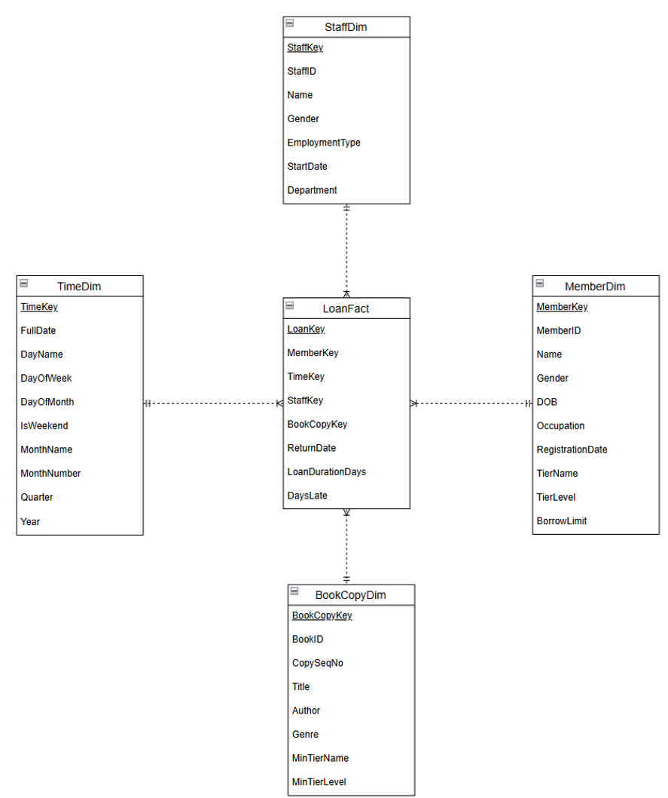

# Library Data Warehouse & SQL Analysis

**MySQL | Data Warehousing | ETL | SQL Analytics**

## Overview

This project builds a star-schema data warehouse for a fictional library and uses SQL to explore borrowing behaviour, membership engagement, book demand, staffing workload, and overdue returns. It was developed as part of a **three-person academic group project**; the portfolio is a curated presentation of the group's work, not a claim of sole authorship.

## Key figures

| Metric | Result |
|---|---:|
| Source loan transactions | 12,344 |
| Completed loans loaded into warehouse | 12,343 |
| Active loans intentionally excluded | 1 |
| Members | 301 |
| Staff | 51 |
| Book copies | 1,265 |
| Time dimension dates | 1,590 |
| Completed loans returned late | 1,045 |

*Figures are from the team's submitted validation report; this repository does not contain the original source dataset.*

## Architecture



- **LoanFact:** one row per completed loan; includes loan duration and days late.
- **TimeDim:** loan start-date attributes, including weekday/weekend.
- **MemberDim:** membership tiers and member attributes.
- **StaffDim:** staff department and employment type.
- **BookCopyDim:** book title, genre and individual-copy attributes.

The ETL loads completed loans only. It excludes a dummy administrative membership tier and checks warehouse row counts and missing dimension keys. The TimeDim is **sparse** (only loan start dates for completed transactions), not a complete calendar.

## Analysis questions

1. How does completed-loan activity differ by weekday versus weekend?
2. How does average borrowing differ by membership tier?
3. Which ten books have the most completed loans?
4. Which departments and employment types handle the most loans?
5. Which genres have longer loans and higher late-return rates?
6. Which three genres are most popular within each membership tier?

## Selected findings

- **Membership engagement:** Premium members averaged **68.0** completed loans per member, versus **34.0** for Basic members. This association does **not** establish that higher tier limits caused more borrowing.
- **Overdue returns:** Business books had the highest reported late-return rate (**10.90%**), followed by History (**9.72%**).
- **Book demand:** *The Living World (3rd Edition)* ranked first with **91** completed loans.
- **Borrowing activity:** On dates with completed loan activity, Saturdays and Sundays averaged **13.6–14.3** loans per observed day, compared with **3.4–4.2** across weekdays. Because the SQL denominator excludes dates with zero completed loans, these figures are **not** calendar-day averages.

**Potential actions:** Consider staffing and service planning around busy periods, monitoring high-demand titles, and targeted overdue reminders. These are recommendations, not measured interventions.

## Repository structure

```text
library-data-warehouse-analysis/
├── README.md
├── sql/
│   ├── 01_create_warehouse.sql
│   ├── 02_load_warehouse.sql
│   └── 03_analysis_queries.sql
└── images/
    └── star_schema.png
```

## How to run

1. Use **MySQL 8+**.
2. Prepare a matching OLTP source database called `library_oltp` with the source tables `Member`, `MembershipTier`, `Staff`, `Book`, `BookCopy`, and `Loan`.
3. Run `sql/01_create_warehouse.sql`.
4. Run `sql/02_load_warehouse.sql`.
5. Run `sql/03_analysis_queries.sql` to reproduce the analytical queries.

**Important:** The original OLTP source data and loading scripts are **not included**, so these files are **not fully runnable as a standalone repository**. The database names were made generic for public presentation. Reported results were not independently rerun after that renaming.

## Methods and limitations

- Uses a denormalised star schema with four dimension tables and one fact table.
- Loads data through `INSERT INTO ... SELECT` statements with joins from OLTP tables.
- Includes validation queries checking row counts, exclusion of active loans and NULL dimension keys.
- Excludes active loans, so the analysis applies only to **completed** transactions.
- The membership-average query counts members present in completed loan transactions, not necessarily every member in a tier.
- The weekday query divides by dates with completed transactions, not every calendar day.

## Attribution 

This project was developed as part of a three-member academic group assignment for the Data Engineering module at Singapore Polytechnic.

## My Contributions:

- Developed SQL scripts for data warehouse creation and data transformation.
- Designed and implemented a star-schema data warehouse.
- Wrote SQL queries to analyse borrowing patterns and library operations.
- Contributed to data validation, interpretation of results and documentation.
